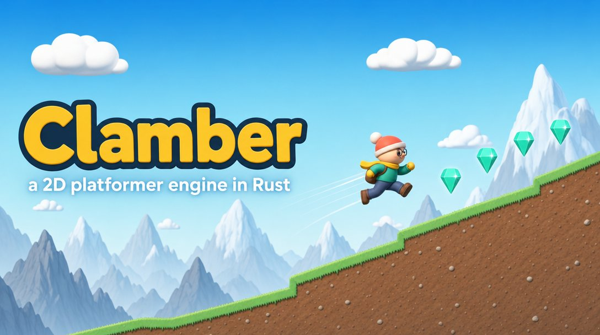
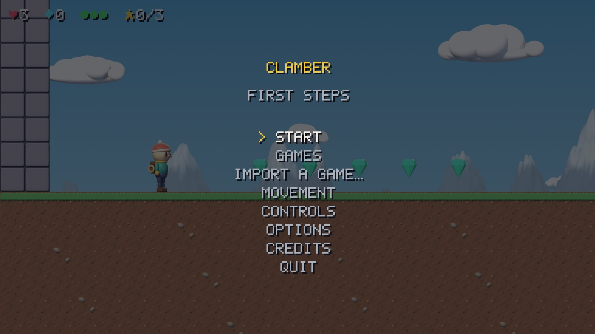
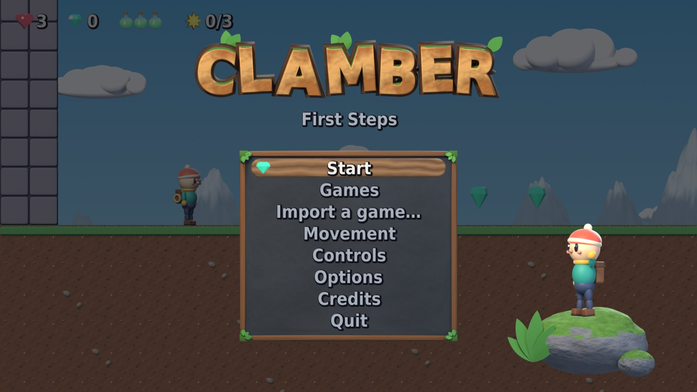
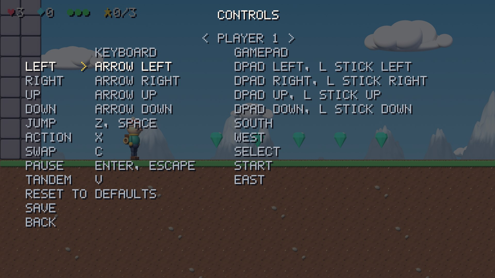
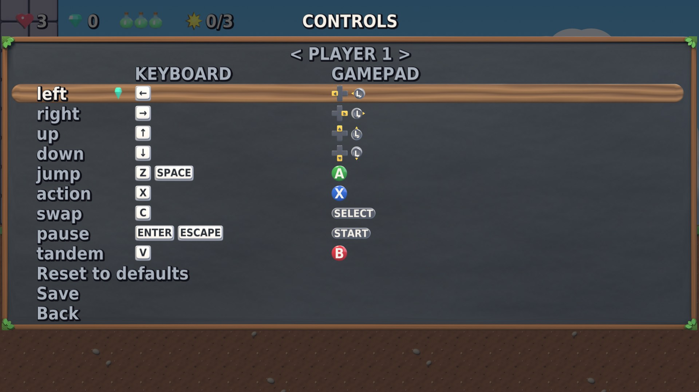
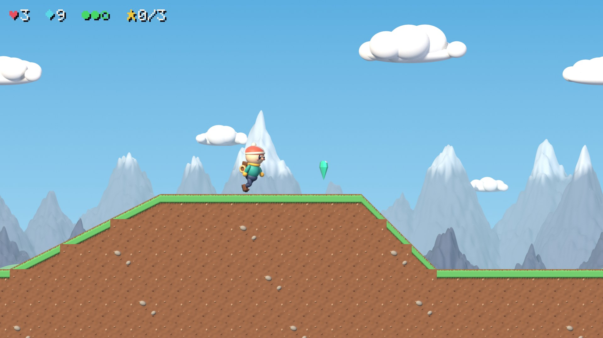
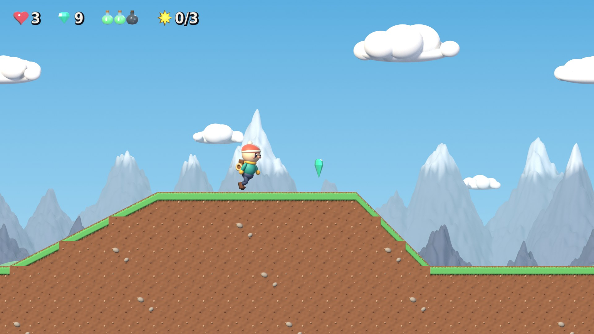

# Clamber Engine

An open-source 2D platformer engine written in Rust, with a
deterministic fixed-point simulation, data-driven movement presets,
content packs, and conformance tests that check behaviour frame by frame.

Clamber ships with its own original game content. It also includes an
importer that can convert data from Donkey Kong Country SNES ROMs you
legally own into Clamber's formats, locally, for personal play. Converted
data is never distributed with or by this project.

Clamber is not affiliated with or endorsed by Nintendo or Rare. Donkey Kong
Country is a trademark of its owners.

## Latest gameplay

Generated automatically by CI from the newest commit on `main` (see #24).
Placeholder art; nothing here is final.

| | |
|---|---|
|  |  |
|  |  |

## UI graphics pass

The title screen, the Controls screen and the HUD before the UI
graphics pass (#198, at 52ce088) and after it (at 0d0ece3). Pixel text
and icons gave way to a vector font, a 3D-rendered logo, icons, panels
and button prompts. Captured with `tools/capture/ui-tour.scn` and
`tools/capture/first-tour.scn`, with `--preset default`.

| Before | After |
|---|---|
|  |  |
|  |  |
|  |  |

## Status

Early setup. The first level is playable: see [`PLAYING.md`](PLAYING.md)
for the Windows build and how to run from source. See `CONTRIBUTING.md`
before contributing; this project follows a clean-room process.

## Repositories

| Repo | Purpose |
|---|---|
| `engine` (this one) | The engine, tools and bundled original content |
| `spec` | Behavior and data-format specifications the engine is built from |

## License

- **Code** (everything outside `content/`, including the art scripts in
  `art/` and the tools) is under the [MIT License](LICENSE).
- **Original content** (the art, levels, sounds and other files in
  `content/`) is under [CC BY 4.0](LICENSE-CC-BY-4.0.txt). Credit it as
  "Clamber Engine contributors".
- **Third-party content** keeps its own licence, listed in
  [`content/base/CREDITS.md`](content/base/CREDITS.md) (for example, the
  music is CC BY 3.0 by CodeManu).
- The [spec](https://github.com/clamber-engine/spec) is CC0.

Clamber contains no content from any original game. Content you import
from your own game stays on your computer and is not covered by these
licences.
